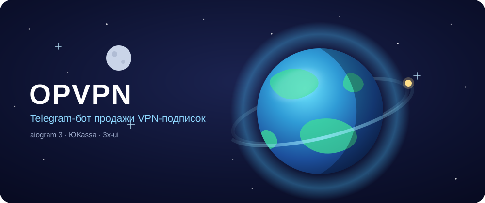

<p align="center">
  
</p>

# OPVPN

Полноценный Telegram-бот для продажи VPN-подписок на **aiogram 3**: витрина тарифов, оплата через **ЮKassa** (карты РФ, СБП, SberPay), автоматическая выдача ключей через панель **3x-ui**, промокоды, поддержка, напоминания и админ-панель прямо в Telegram.

Установщик (Debian/Ubuntu) спросит токен бота, ваш Telegram ID, способы оплаты и режим выдачи ключей, затем поставит зависимости, создаст `.env`, заведёт systemd-службу `opvpnbot` и запустит бота с автозапуском. Если указать домен — он же настроит **nginx + HTTPS (Let's Encrypt)** для вебхука ЮKassa и `/healthz` и включит **ufw** (SSH/80/443 открываются ДО включения, чтобы не потерять доступ к серверу).

Развернуть всё одной командой:

```bash
sudo bash install.sh --domain bot.example.com --email you@example.com --yes
```

Полезные режимы:

```bash
sudo bash install.sh --update      # обновить код и перезапустить
sudo bash install.sh --uninstall   # удалить службу (база и .env останутся)
sudo bash install.sh --yes         # без вопросов, значения из переменных окружения
sudo bash install.sh --no-nginx --no-firewall           # только бот, без nginx и ufw
sudo bash install.sh --dir /srv/opvpnbot --no-service   # свой каталог, без systemd
```

Управление после установки:

```bash
systemctl status opvpnbot
journalctl -u opvpnbot -f     # живые логи
systemctl restart opvpnbot
```

## 🐳 Установка через Docker

```bash
git clone https://github.com/zymzymgl-del/opvpnbot.git && cd opvpnbot
cp .env.example .env && nano .env      # заполните BOT_TOKEN, ADMIN_IDS и остальное
docker compose up -d --build
docker compose logs -f
```

## 🛠 Ручная установка

```bash
git clone https://github.com/zymzymgl-del/opvpnbot.git && cd opvpnbot
python3.12 -m venv .venv && .venv/bin/pip install -r requirements.txt
cp .env.example .env && nano .env       # токен, админы, оплата, панель
.venv/bin/python bot.py
```

Проверить, что всё собрано корректно, можно без Telegram:

```bash
.venv/bin/python tools/selftest.py          # проверки логики без сети (100+)
.venv/bin/python tools/integration_test.py  # прогон апдейтов через диспетчер
```

> На Windows вывод с эмодзи может ломаться в cp1251 — запускайте с `PYTHONIOENCODING=utf-8`.

---

## ✨ Возможности

### Для клиентов

| Функция                 | Описание                                                                                     |
| ----------------------- | -------------------------------------------------------------------------------------------- |
| 🛒 Витрина тарифов      | Цены, сроки, лимиты трафика и устройств — редактируются из админки без перезапуска           |
| 💳 Оплата               | Карта РФ / СБП / SberPay через **ЮKassa**                                                    |
| 🎟 Промокоды            | Процент или фиксированная сумма, лимит активаций и срок действия                             |
| 🎁 Пробный период       | Бесплатный доступ на N дней один раз на пользователя                                         |
| 🔑 Мои ключи            | Карточка подписки, ссылка-конфиг, подписка, **QR-код**, инструкция под конкретное приложение |
| 🔄 Продление в один тап | Конфиг остаётся тем же, срок сдвигается (в 3x-ui продление применяется в панели)             |
| ⏰ Напоминания          | За 3 дня и за 1 день до окончания, с кнопкой «Продлить»                                      |
| 🆘 Поддержка            | Встроенные тикеты: пользователь пишет в боте, админ отвечает из админки                      |
| 📲 Инструкции и FAQ     | Готовые подсказки под v2rayNG, Streisand, Shadowrocket, Hiddify, NekoBox/NekoRay             |
| 📄 Документы            | `/terms` и `/privacy` (тексты можно заменить своими через `.env`)                            |

### Для администратора (всё в Telegram, команда `/admin`)

- **📊 Статистика** — пользователи за сутки/неделю, активные подписки, выручка за день/30 дней/всё время.
- **💰 Заказы** — список ожидающих, ручное подтверждение оплаты в один тап (для переводов и крипты).
- **🧪 Проверить панель** — проверка связи с панелью 3x-ui.
- **🔧 Обслуживание** — перезапуск бота и ядра Xray из админки (с подтверждением).
- **🔗 QR для клиента** — привязка уже созданного в панели 3x-ui клиента к Telegram: бот отдаёт ссылку/QR `?start=claim_…`, клиент открывает бота и дальше продлевает сам.
- **👥 Пользователи** — поиск по ID/@username/номеру заказа, карточка (подписки, заказы), сообщение от админа, выдача подписки, блокировка, отзыв устройств.
- **🎟 Промокоды** — создание, включение/выключение, удаление, статистика активаций.
- **📢 Рассылка** — всем / только с активной подпиской / только без подписки, с отчётом о доставке.
- **🧾 Тикеты** — открытые обращения, ответ и закрытие прямо из чата с ботом.
- **🎛 Настройки** — тарифы (цена, срок, трафик, устройства, скрыть/показать), дни пробного периода.
- **💾 Бэкап** — бот присылает файл базы данных админу.
- **🚀 Старт-уведомление** — админам приходит сообщение о запуске с версией, панелью и способами оплаты.

### Технические фишки

- long-polling (не нужен домен) — или вебхуки ЮKassa отдельным HTTP-сервером, если есть публичный адрес;
- **проверка платежа по API** (телу вебхука не доверяем — сверяем сумму и статус);
- резервный опрос ЮKassa раз в 3 минуты, если вебхуки выключены;
- фоновая обработка: истечение подписок (с отключением клиента в панели), напоминания, автоотмена «висящих» заказов;
- анти-спам троттлинг и обязательная подписка на каналы (проверка `getChatMember`);
- лог платежей, логи с ротацией;
- автоматическая проверка конфигурации на старте — понятные сообщения об ошибках.

---

## 🔑 Выдача ключей: панель 3x-ui

Выдача и продление идут через API панели **3x-ui** (`VPN_PANEL=xui`): бот создаёт клиента, а панель отдаёт ссылку подписки (или бот собирает прямые конфиги — `vless/vmess/trojan`, reality/ws/tls/grpc).

Подробная настройка: **[docs/SETUP-PANELS.md](docs/SETUP-PANELS.md)**.

## 💳 Оплата: что включить

| Способ     | Что нужно                                                      | Подробно                                         |
| ---------- | -------------------------------------------------------------- | ------------------------------------------------ |
| `yookassa` | `YOOKASSA_SHOP_ID` + `YOOKASSA_SECRET_KEY`, при желании вебхук | [docs/SETUP-PAYMENTS.md](docs/SETUP-PAYMENTS.md) |

Список активных способов — переменная `PAYMENT_METHODS=yookassa`.

---

## 🌐 nginx: вебхук ЮKassa и мониторинг

Нужен, если хотите **мгновенные** уведомления ЮKassa (вместо опроса раз в 3 минуты)
и/или внешний монитор `/healthz`. Без домена бот отлично работает и без nginx — см.
[docs/SETUP-PAYMENTS.md](docs/SETUP-PAYMENTS.md).

**Проще всего — доверить это установщику:** `sudo bash install.sh --domain <домен> --email <адрес>`,
и он сам поставит nginx + certbot, выпустит сертификат, отрендерит конфиг из
[`deploy/nginx/opvpnbot.conf.tmpl`](deploy/nginx/opvpnbot.conf.tmpl), включит `WEBHOOK_ENABLED`,
`WEBHOOK_TRUST_PROXY` и `WEBHOOK_HOST=127.0.0.1`, а также закроет лишние порты через ufw.
Ниже — ручной вариант, если nginx уже занят другими сайтами или нужна своя конфигурация.

### 1. Установка nginx и HTTPS-сертификата

```bash
sudo apt update && sudo apt install -y nginx certbot python3-certbot-nginx
sudo certbot --nginx -d tg1.openplanetvpn.com     # выпустит Let's Encrypt и настроит HTTPS
```

### 2. Конфиг (вебхук + healthcheck в одном server-блоке)

`/etc/nginx/sites-available/opvpnbot`:

```nginx
server {
    listen 443 ssl;
    server_name tg1.openplanetvpn.com;

    ssl_certificate     /etc/letsencrypt/live/tg1.openplanetvpn.com/fullchain.pem;
    ssl_certificate_key /etc/letsencrypt/live/tg1.openplanetvpn.com/privkey.pem;

    # ЮKassa → бот: мгновенная выдача доступа после оплаты
    location /yookassa/webhook {
        proxy_pass http://127.0.0.1:8080/yookassa/webhook;
        proxy_http_version 1.1;
        proxy_set_header Host $host;
        proxy_set_header X-Real-IP $remote_addr;
        # ОБЯЗАТЕЛЬНО при WEBHOOK_TRUST_PROXY=true: иначе бот не увидит IP ЮKassa → 403
        proxy_set_header X-Forwarded-For $proxy_add_x_forwarded_for;
        proxy_read_timeout 30s;
        proxy_send_timeout 30s;
    }

    # Healthcheck для внешнего uptime-монитора
    location = /healthz {
        proxy_pass http://127.0.0.1:8081/healthz;
        proxy_set_header Host $host;
        # при желании ограничьте доступ, например только IP монитора:
        # allow 203.0.113.10; deny all;
    }
}
```

```bash
sudo ln -s /etc/nginx/sites-available/opvpnbot /etc/nginx/sites-enabled/
sudo nginx -t && sudo systemctl reload nginx
```

### 3. Проверка

```bash
curl -s https://tg1.openplanetvpn.com/healthz        # → {"ok": true}
sudo tail -f /var/log/nginx/error.log
```

### 4. Что заполнить в `.env`

```env
WEBHOOK_ENABLED=true
WEBHOOK_PUBLIC_URL=https://tg1.openplanetvpn.com/yookassa/webhook
WEBHOOK_TRUST_PROXY=true     # бот за nginx — обязательно, иначе вебхуки получат 403
```

Тот же адрес укажите в кабинете ЮKassa (**Интеграция → HTTP-уведомления**, событие
`payment.succeeded`), а `https://tg1.openplanetvpn.com/healthz` — во внешнем мониторе
(healthchecks.io / UptimeRobot / Better Stack). После правок: `sudo systemctl restart opvpnbot`.

---

## ⚙️ Основные настройки `.env`

Полный список с комментариями — в [.env.example](.env.example). Самое важное:

| Переменная                                         | Назначение                                                                                   |
| -------------------------------------------------- | -------------------------------------------------------------------------------------------- |
| `BOT_TOKEN`                                        | Токен от [@BotFather](https://t.me/BotFather)                                                |
| `ADMIN_IDS`                                        | Telegram ID админов через запятую ([@userinfobot](https://t.me/userinfobot))                 |
| `VPN_PANEL`                                        | `xui`                                                                                        |
| `XUI_VERIFY_SSL`, `XUI_CA_FILE`                    | Проверка TLS-сертификата панели (по умолчанию `true`); свой CA для self-signed               |
| `CLAIM_ENABLED`, `CLAIM_SECRET`, `CLAIM_TTL_HOURS` | Привязка существующих клиентов 3x-ui к боту по QR/ссылке (только `xui`); срок ссылки в часах |
| `PAYMENT_METHODS`                                  | `yookassa`                                                                                   |
| `TRIAL_ENABLED`, `TRIAL_DAYS`                      | Пробный период                                                                               |
| `MAX_PENDING_ORDERS`                               | Лимит неоплаченных заказов на пользователя (запасной предохранитель; пока есть хоть один незакрытый заказ, новый не создаётся) |
| `REQUIRED_CHANNELS`                                | `@ch1,@ch2` — обязательная подписка (бот должен быть админом канала)                         |
| `YOOKASSA_*`                                       | Доступы магазина ЮKassa (shopId + секретный ключ)                                            |
| `WEBHOOK_ENABLED`, `WEBHOOK_PUBLIC_URL`            | Приём уведомлений ЮKassa (нужен публичный HTTPS)                                             |
| `HEALTH_ENABLED`, `HEALTH_HOST`, `HEALTH_PORT`     | HTTP-эндпоинт `GET /healthz` для внешнего мониторинга (uptime)                               |
| `NOTIFY_DAYS_BEFORE`                               | За сколько дней напоминать: по умолчанию `3,1`                                               |
| `AUTO_DISABLE_EXPIRED`                             | Отключать клиента в панели при истечении подписки                                            |

Тарифы и пробный период можно менять прямо в админке (значение из админки приоритетнее `.env` для пробного периода).

## ✅ Чек-лист перед продакшеном

Минимум, что нужно заполнить и проверить перед первым запуском для реальных пользователей.

**Обязательно в `.env`**

- [ ] `BOT_TOKEN` — токен от [@BotFather](https://t.me/BotFather)
- [ ] `ADMIN_IDS` — ваш Telegram ID (админам идут заказы, ошибки и алерты)
- [ ] `VPN_PANEL=xui` + `XUI_URL`, `XUI_API_TOKEN` (или логин/пароль), `XUI_INBOUND_IDS`
- [ ] `XUI_VERIFY_SSL=true` (по умолчанию) и `XUI_CA_FILE`, если сертификат панели самоподписанный
- [ ] `XUI_SUB_BASE` — если нужна одна ссылка-подписка на несколько inbound'ов
- [ ] `PAYMENT_METHODS=yookassa` + `YOOKASSA_SHOP_ID`, `YOOKASSA_SECRET_KEY` (боевой магазин; `YOOKASSA_TEST=false`)
- [ ] `WEBHOOK_ENABLED=true` + `WEBHOOK_PUBLIC_URL`, и тот же адрес прописан в кабинете ЮKassa

**Проверить после запуска**

- [ ] `curl -fsS http://127.0.0.1:8081/healthz` → `{"ok": true}`
- [ ] адрес `/healthz` добавлен во внешний монитор (healthchecks.io / UptimeRobot) — алерт, если бот упал
- [ ] в логе при старте: `Панель 'xui': OK` и `3x-ui TLS: проверка включена`
- [ ] тестовая покупка от начала до конца: заказ → оплата → ключ пришёл (можно на тестовом магазине ЮKassa)
- [ ] резервная копия: `/admin` → 💾 Бэкап базы

**Не обязательно, но полезно**

- [ ] `REQUIRED_CHANNELS` — обязательная подписка (бот должен быть админом этих каналов)
- [ ] `CLAIM_ENABLED=true` + `CLAIM_SECRET` — привязка готовых клиентов панели к Telegram
- [ ] `MAX_PENDING_ORDERS` — лимит неоплаченных заказов на пользователя

Диагностика инцидентов — в [docs/RUNBOOK.md](docs/RUNBOOK.md).

## 🧭 Команды бота

**Пользователю:** `/start` · `/menu` · `/help` · `/terms` · `/privacy`
**Админу:** `/admin` · `/stats`

## Мониторинг и CI

### Healthcheck

Бот поднимает `GET /healthz` (по умолчанию `127.0.0.1:8081`), который проверяет доступность БД и отдаёт `200 {"ok": true}` либо `503`. Это то, за чем следит внешний монитор.

```bash
curl -fsS http://127.0.0.1:8081/healthz && echo OK
```

Для systemd — проксируйте адрес через nginx (см. «🌐 nginx: вебхук ЮKassa и мониторинг»); для Docker задайте `HEALTH_HOST=0.0.0.0` и пробросьте порт.

### Уведомления о падении

**Вариант 1 — UptimeRobot / healthchecks.io / Better Stack (проще, если есть домен).** Бесплатного тарифа хватает.

1. Откройте `/healthz` через nginx (раздел «🌐 nginx…») и проверьте публичный адрес: `curl -fsS https://<домен>/healthz` → `{"ok": true}`.
2. Зарегистрируйтесь на [uptimerobot.com](https://uptimerobot.com) → **Add New Monitor** → тип **HTTP(s)**.
3. URL `https://<домен>/healthz`, интервал 5 минут; в **Alert Contacts** добавьте **Telegram** и/или email.
4. Проверьте, что алерт действительно приходит: `sudo systemctl stop opvpnbot` → через ~5 минут придёт уведомление; `sudo systemctl start opvpnbot` → затем придёт «recovered».

**Вариант 2 — cron + Telegram (бесплатно, адрес наружу не выставляется).** Проверяем локально и пишем в чат с ботом:

```cron
*/5 * * * * curl -fsS --max-time 5 http://127.0.0.1:8081/healthz >/dev/null \
  || curl -fsS "https://api.telegram.org/bot<BOT_TOKEN>/sendMessage" \
       -d chat_id=<ADMIN_ID> -d text="OPVPN: бот не отвечает"
```

> Мониторинг ничего не «чинит» — он лишь сообщает раньше, чем это заметят клиенты. Действия при сбоях — в `docs/RUNBOOK.md`.

### CI

GitHub Actions (`.github/workflows/ci.yml`) на каждый push/PR гоняет `ruff check` + `tools/selftest.py` + `tools/integration_test.py`, а также `pip-audit` (известные уязвимости в зависимостях) и проверку `requirements.lock.txt`.

## 🗂 Структура проекта

```
bot.py                     точка входа: конфиг, диспетчер, polling, фоновые задачи
app/config.py              чтение и валидация .env
app/db.py                  SQLite: пользователи, заказы, подписки, промо, тикеты
app/runtime.py             настройки, изменяемые из админки на лету
app/keyboards.py           все клавиатуры
app/middlewares.py         троттлинг, регистрация, обязательная подписка, ошибки
app/utils.py               форматирование, QR-коды, инструкции
app/handlers/user.py       магазин, оплата, ключи, профиль, поддержка
app/handlers/admin.py      админ-панель
app/services/panels.py     панель 3x-ui
app/services/payments.py   ЮKassa API (REST v3)
app/services/subs.py       выдача, продление, истечение, напоминания
app/webhook.py             HTTP-сервер уведомлений ЮKassa
app/health.py              healthcheck GET /healthz для внешнего мониторинга
tools/selftest.py          автотест логики без сети
tools/integration_test.py  тест маршрутизации апдейтов через диспетчер
install.sh                 установщик на VPS одной командой
Dockerfile                 образ для Docker
docker-compose.yml         запуск бота в контейнере (том для data/)
requirements-dev.txt       инструменты разработки (не обязательны)
requirements.lock.txt      lock-файл (точные версии всех зависимостей)
.env.example               образец конфигурации → копируется в .env
deploy/opvpnbot.service    образец systemd-юнита
deploy/nginx/opvpnbot.conf.tmpl  шаблон сайта nginx (рендерит install.sh)
docs/                      инструкции, архитектура, runbook оператора
```

## 🧯 Частые вопросы

**Нужен ли домен?** Для мгновенных вебхуков ЮKassa — да (и его настроит установщик: `sudo bash install.sh --domain bot.example.com --email you@example.com`). Без домена бот тоже работает: сам проверяет оплату каждые 3 минуты, а пользователь может нажать «🔄 Проверить оплату».

**Как обновить бота?** `sudo bash install.sh --update` (код скачается заново, `.env` и база сохранятся) или `git pull && systemctl restart opvpnbot`.

**Как забэкапить базу?** `/admin` → 💾 Бэкап базы — бот пришлёт файл SQLite. Данные и логи лежат в `data/`.

**ЮKassa: пишет, что платёж не подтверждён.** Проверьте, что `YOOKASSA_SHOP_ID`/`SECRET_KEY` из одного магазина, а в кабинете ЮKassa указан тот же адрес уведомлений, что в `WEBHOOK_PUBLIC_URL`.

**Можно ли подключить свою панель?** Да: добавьте класс-наследник `BasePanel` в `app/services/panels.py` с методами `create_client/extend_client/set_enabled/delete_client` и зарегистрируйте его в `get_panel()`.

## 👤 Автор и основа

Проект **OPVPN** — на основе **DF VPN Bot**.

**[@Dolov07KBR](https://github.com/Dolov07KBR)** — автор базового проекта (разработка, дизайн и поддержка).

## ⚠️ Дисклеймер

Проект предоставляется «как есть» для легального использования (личный VPN, корпоративный доступ к своим ресурсам). Перед продакшеном настройте оферту, политику конфиденциальности и налоговый учёт в вашей юрисдикции. Автор не несёт ответственности за использование сервиса третьими лицами.

## 📄 Лицензия

MIT — см. [LICENSE](LICENSE).
